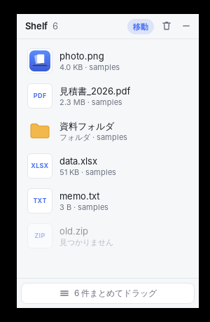

# Shelf

ファイルを移動するときの「一時置き場」になる、Yoink 風の小さなアプリです。Tauri 2 製で、macOS と Windows を対象にしています。



## できること

- **置く**: Finder / エクスプローラからファイルやフォルダを棚にドロップ
- **出す**: 棚のアイテムを目的のフォルダやアプリへドラッグ
  - ヘッダーの「移動 / コピー」で、ドラッグで出したときの動作を切り替え（既定は移動）
  - Alt（macOS は Option）を押しながらドラッグすると、その回だけ逆の動作
  - 移動で出したファイルは棚から自動で消えます
- **まとめて出す**: クリックで選択（⌘/Ctrl で追加、Shift で範囲）。選択中のアイテムか、未選択なら全部を下の「まとめてドラッグ」から一度に出せます
- ダブルクリックで開く、行のボタンで Finder / エクスプローラに表示・棚から外す
- Delete / Backspace で選択を棚から外す、⌘/Ctrl+A で全選択
- 画面右端に常に最前面で表示。「—」で隠し、メニューバー / タスクトレイのアイコンから再表示。終了はトレイのメニューから

棚が覚えているのはファイルの**場所だけ**です。アプリ内にコピーは作らないので、棚から外してもファイル自体は消えません。元の場所でファイルが消えたり移動したりしたアイテムはグレーで「見つかりません」と表示されます。棚の中身は再起動しても残ります（保存先: アプリのデータフォルダの `shelf.json`）。

## 開発

必要なもの: [Tauri の前提ツール](https://v2.tauri.app/start/prerequisites/)（Rust、Node.js 20 以上、macOS は Xcode Command Line Tools、Windows は WebView2 と MSVC ビルドツール）

```sh
cd shelf
npm install
npm run tauri dev      # 開発モードで起動
npm run tauri build    # インストーラを作成（src-tauri/target/release/bundle/）
cargo test --manifest-path src-tauri/Cargo.toml
```

GitHub Actions（`.github/workflows/shelf.yml`）で macOS（Universal）と Windows のビルドが走り、`.dmg` / `.msi` / `.exe` が Artifacts に上がります。`shelf-v0.1.0` のようなタグを push すると、同じビルドから GitHub Release が作られます（本文は `CHANGELOG.md` の該当バージョンの節。タグと `tauri.conf.json` のバージョンが一致しないと失敗します）。署名はしていないので、初回起動時は macOS なら右クリック →「開く」、Windows なら SmartScreen の「詳細情報」→「実行」で起動してください。

## 構成

| パス | 役割 |
| --- | --- |
| `src/main.ts` | 画面。ドロップの受け取り、選択、ドラッグで出す処理 |
| `src-tauri/src/shelf.rs` | 棚のデータ（パスの一覧）と JSON への保存 |
| `src-tauri/src/lib.rs` | Tauri のコマンド、トレイ、ウィンドウ配置 |

アプリ外へのドラッグは OS ネイティブのドラッグが必要なので [tauri-plugin-drag](https://github.com/crabnebula-dev/drag-rs) を使っています。

## 今後の候補

- グローバルショートカットで表示切替
- 画面端にカーソルを寄せたら出てくる（Yoink の自動表示）
- テキストや画像データ（ファイル以外）のドロップ
- 各アイテムのプレビュー（Quick Look 等）
